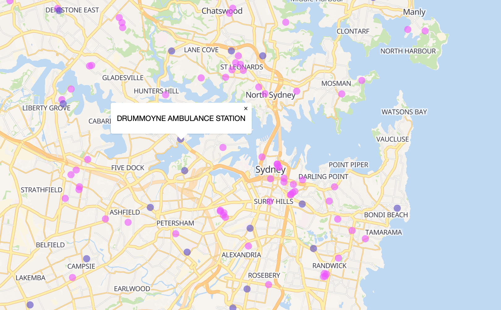

# Screenshot of map:

# Reflective analysis:
I designed my map for New South Wales health researchers who need to know where hospitals and ambulance stations are, as well as the transportation infrastructure that residents might use to get there. The map attempts to ask where hospitals are in New South Wales and how proximate they are to road infrastructure and ambulance stations.

Since part of my question is about road infrastructure, I modified a basemap style so that major and minor roads, as well as subway and ferry systems, are visible. The health facilities are circles with slightly transparent fill so the density of health facilities can be gauged at smaller zooms. I wanted a map that can be used for navigation, and my map achieved that because the basemap style has transportation information. I made the map work at multiple zoom levels via the interpolate method when designing the symbols' paint specifications, so that at different zoom levels, the symbol radii change. I think the map can be improved so that the popups show more information about the hospital/ambulance station, such as their capacity or if they have emergency departments/some other medical department or not.

Cartographic principles:
* visual contrast: the symbol colours for the health facilities stand out from the basemap colours and cannot be mistaken for vegetation or water body features.
* legibility: even without a legend, the map is straightforward about what differently-coloured symbols mean: one colour represents hospitals, and the other represents ambulance stations. This is reinforced with the popups showing names that end with 'STATION' or 'HOSPITAL'.

# Link to map:
# From map critique session:
A friend noted that a legend and info about the data sources would have made the map more useful for users. However, creating a legend is outside the 

