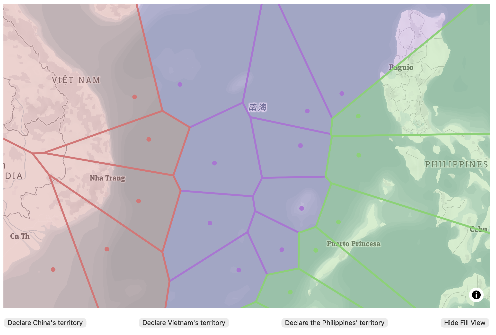

GEOS472: Research in Geography | 
Exploratory Lab 2 | 
Michelle Huang (27444397) | 
November 2026

# Title: Conflicting territories in the South China Sea

## Topic background
Since 2020, the Paracel and Spratly Islands in the South China Sea have driven territorial disputes between Asian countries including China, Vietnam, and the Philippines. This is an extension of ambiguous territorial delineations stemming from the 1951 San Francisco Treaty.

Source: The Peace Palace Library. ‘South China Sea Territorial Disputes’. The International Law Library, Carnegie Foundation, https://peacepalacelibrary.nl/research-guide/south-china-sea-territorial-disputes.

## How the user should interact with the map

In this exploratory lab, users first see the location of the Spratly Islands. They are encouraged to zoom out and mark where they believe Chinese, Vietnamese, and the Philippines' territories lie. 

Through turf.js' Voronoi polygons generation function, the territories extending from the user-determined points are calculated. The combined territories can be visualised by clicking the Show Fill View button.

## Screenshot of map

## Link to map
https://michellechuqi.github.io/michellechuqi-web/lab2/lab2-map.html

## Where to find source code
https://raw.githubusercontent.com/michellechuqi/michellechuqi-web/main/lab2/lab2-map.html

## Collaborations and reliance on other resources
I did not peer-critique during the Lab 2 process.
I used ChatGPT to give me keywords that concerned the code syntax that would do what I wanted it to do but didn't learn in class. I would then search up that keyword in online forums and coding tutorial web pages. This would include wanting a row of buttons --> ChatGPT says to look for "flexbox" --> I find flexbox syntax elsewhere online.
Instances of AI and other online resources use:
* line 76-192: I kept running into issues of the code running so I consulted AI to tell me, at a high-level, when to add a source versus when to add a layer.
* line 213: I wrote out if (country === and didn't know what value to put to represent no value; I knew an empty string wouldn't work so I asked AI what value to use in this specific instance and it said null.
* the .featureCollection wasn't combining the arrays as I wanted it to, because the elements were still in their own arrays. I asked "what key operator would make the elements of an array 'flat' rather than nested in their separate arrays?' and ChatGPT said to search up the 'spread operator'.
* line 245-276: I knew I needed to filter elements and make new arrays, so I reviewed how filter() works. I confirmed with ChatGPT that turf.featureCollections implies a push.
⋅⋅⋅⋅* line 247: I wrote the iteration as function checkChina(index) but it wasn't running, I sent the code through ChatGPT asking why. It said index is a number but what you're intending to pass are polygons, which would need another parameter. So I added polygons.
* line 280: I knew my previous fill layers' visibility was set to none (see line 97) so I asked ChatGPT how to change that value, and it said to look up the ".setLayoutProperty" syntax.
* line 290: I needed to change the button text so I asked ChatGPT what keyword I should use, and it said look up the syntax for ".textContent".

## Reflective analysis
I designed the map for an audience with some understanding of the South China Sea territorial dispute––more specifically, I assume that the audience knows about how the Spratly Islands is a contested feature. The map addresses the question of how claiming the Spratly Islands as either China's/Vietnam's/the Philippines' territory can change the delineation of that country's territory as a whole, if territorial bounds are calculated using Voronoi polygons.
  
  I first used the template from the tutorial on using turf.js and .voronoi to get clickable points that would generate Voronoi polygons. The user can generate as many points as they want, thus the program allows for deep interface complexity. The user can add points to the map using their mouse to determine the position, which provides better interface style than that of a less intuitive inputting lat-long coordinates manually. Visual perception of the territories' shapes is aided by toggling fill view using the View/Hide Fill View button. There is constant feedback given to the user through console.log statements, which give the country and the lat-long coordinates of each point made in Developer Mode on the map browser. I then puzzled through how to give the polygons their separate country identity, which would then feed into different fill colours. The user creates a thematic map based on their understanding/experimentation of maritime territory, so I chose a simple basemap style where the water is the visual centrepoint. The colours for each country do not have a connotation of right/wrong or differing priority, as that is not the purpose of my map.
  
  My map can be improved with adding options to declare more countries' territories, as the real issue has more than 3 countries involved. There should also be an option to clear the Voronoi polygons and start anew without refreshing the page. I ran out of time to implement both possible improvements. 
